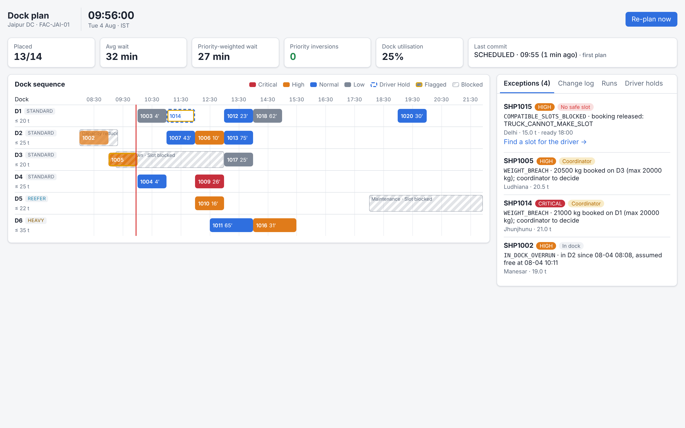

# SetuHaul warehouse dock slot planner

A dock-sequencing solver, capacity layer and planning frontend for SetuHaul Logistics' receiving
warehouses. When a truck runs late or early, the solver re-plans dock slots for the next 12 hours so
that no two trucks are ever promised the same dock at the same time, and higher-priority loads wait least.

The design, constraints, objective and decisions are in the plan document:
[SetuHaul Dock Sequencing Solver: Plan](https://claude.ai/artifact/7F818ubM84vjsf6qZ4DowC).

## Run it on your machine

Needs Docker with Compose v2.

```bash
git clone https://github.com/Vikasharista/warehousedockslotplanner.git
cd warehousedockslotplanner
docker compose up --build
```

Then open **http://localhost:5173** and sign in with the local demo account **demo@setuhaul.local** /
**setuhaul-demo-2026** (local only). The first build downloads the Maven, Go, npm and Python dependencies and takes
a few minutes; later starts are quick. What starts:

| Service | Port (localhost only) | What it does |
| --- | --- | --- |
| `db` | 55432 | Postgres 16 |
| `seed` | | Loads the snapshot and starts the shared clock at 4 Aug 2026 09:55 IST, once; later starts keep your data |
| `gps` | | Simulated GPS on the three lanes and the ETA service, every 30 s |
| `solver` | 8081 | Plans, validates, commits; re-plans on ETA shifts, check-ins and every 15 minutes |
| `api` | 8082 | dock-api: the screens' API, driver holds and the [driver agent API](docs/agent-api.md) |
| `web` | 5173 | The plan view and the Shipments, Capacity, Driver cases and Driver chat screens |
| `agent` | | The driver chat agent ([agent/](agent/README.md)): Telegram with `TELEGRAM_TOKEN` in `.env`, idle without it |

The first start also loads a **load test**: 70 generated truck requests on top of the snapshot's 20. Fifty are known
at 09:55 and twenty arrive between 10:00 and 17:00, with delays, a dock breakdown and coordinator cases. That fills
the docks and leaves some trucks for a coordinator. "Add requests" in the plan view adds more at any time.
`SETUHAUL_SCENARIO_TRUCKS=0 docker compose up --build` on the first start gives the snapshot alone (see
`jobs/README.md`).

Screens, across the top of the page:

- **Plan**: the dock sequence, exceptions, change log, runs and driver holds.
- **Shipments**: every open truck request with its ETA, slot and plan status. Add a request, edit one, record a
  driver ETA or an operations override, or check a truck in at the gate.
- **Capacity**: take docks in or out of service, record breakdowns or maintenance, block or reopen single slots.
- **Driver cases**: what the driver agent hands to a person. HIGH and CRITICAL slot changes wait here for approval
  (the old booking stands and the new slot is reserved for 60 minutes). Escalated cases can be answered, and the reply
  reaches the driver. Open driver exceptions each open their conversation.
- **Driver chat**: a test console that plays a driver and calls the agent API a WhatsApp bot would use (local agent key
  `local-agent-key-for-development-only`, header `X-Agent-Key`).

Every change re-plans; the plan view shows the result within a few seconds.

`docker compose down -v` throws the data away; the next `up` starts again from the snapshot at 09:55.

**Deploying for reviewers:** [docs/deploy.md](docs/deploy.md) covers any Linux VM. It adds HTTPS, the demo accounts
you choose, and a nightly reset to the start of the demo day.



## Layout

| Folder | What lives there | Stack |
| --- | --- | --- |
| [`data/routes/`](data/routes/) | The three fixed truck routes into the Jaipur DC (OpenRouteService, OpenStreetMap data) | GeoJSON |
| [`data/setuhaul/`](data/setuhaul/) | The supplied SQLite snapshot (4 August 2026) and its schema, dictionary and guide. Read-only seed | SQLite |
| [`db/`](db/) | Postgres schema ported from the snapshot, and the data-audit queries | Postgres 16 |
| [`jobs/`](jobs/) | Python jobs: seed loader, data audit, plan validator, GPS simulator and ETA service | Python 3.12+ |
| [`solver/`](solver/) | The dock-sequencing solver | Java 17+, Maven, Timefold Solver |
| [`services/`](services/) | [`dock-api`](services/dock-api/): the plan view's API and driver holds (hold, confirm, release). [`core-lib`](services/core-lib/): the Go services' shared library | Go 1.24+ |
| [`web/`](web/) | The plan view (dock sequence, exceptions, change log, runs, driver holds) and the Shipments, Capacity, Driver cases and Driver chat screens | React, TypeScript, Vite |
| [`agent/`](agent/) | The driver chat agent: Telegram (WhatsApp optional), talking to the planner only through its agent API | Python 3.12+ |
| [`docs/`](docs/) | Data audit report, [driver agent API](docs/agent-api.md) and its [Telegram bot guide](docs/telegram-agent.md), [deployment](docs/deploy.md), [verification matrix](docs/verification.md), [phase 6 results](docs/results/phase6/) ([readout](https://claude.ai/artifact/5Hawn7Pmg39pbhSTFByMFs)) | Markdown |
| [`scripts/`](scripts/) | `break-and-defend.sh`: rebuilds the baseline comparison and scale tables | Bash |

Postgres is the runtime database. The SQLite file is kept unchanged as the seed source.

## Delivery phases

1. Data audit and Postgres seed
2. Solver model and constraints
3. Snapshot service, plan tables, GPS lanes, simulator and ETA service, core library for the Go services
4. Commit path, re-plan triggers, driver holds and the plan view (the plan view moved up from phase 5)
5. Agent hooks and the rest of the frontend
6. Integrity, scale and baseline tests; client readout
7. The driver chat agent moved into this repository, coordinator approvals for priority changes, the Driver cases
   screen ([plan](https://claude.ai/artifact/CEhBRBoLMYFSsm8Yce24ny))

Each phase lands as a branch and a pull request.
