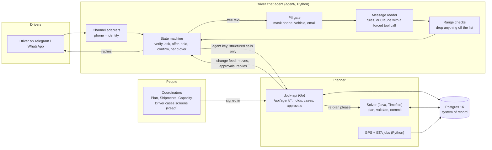
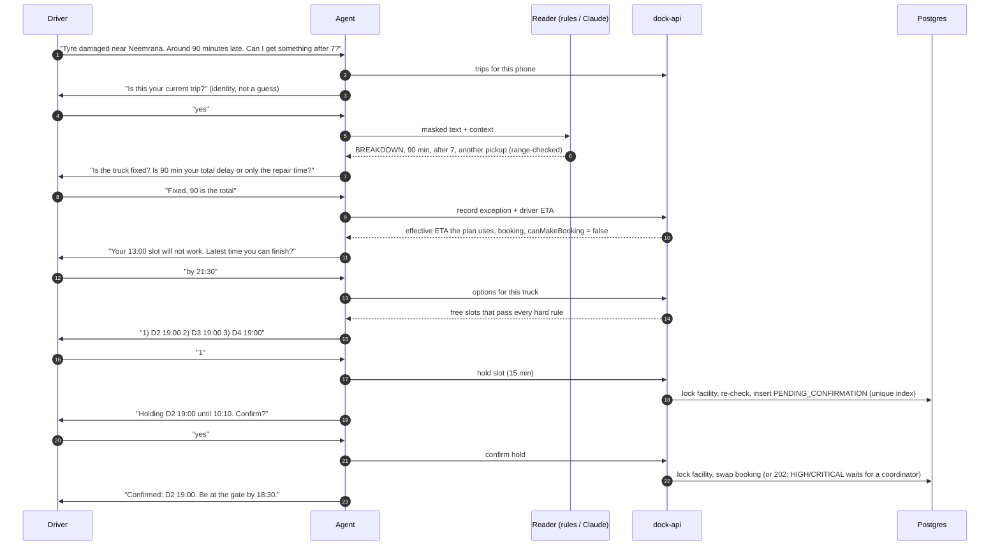

# Architecture

The architecture sketch for the brief's "Design" step. It shows who decides what (a model, a tool, the database or a
person), the path of one driver message, and why two drivers can never hold the same slot. The decisions behind it are
in the [decision register](decision-register.md).

## The system on one page

The rules that hold the picture together:

- **The model reads; code decides; the planner decides what is possible.** The language model, when it is used at all,
  only turns a driver's words into fields. It never sees availability and never books.
- **The agent has no SQL and no clock.** It reaches the planner only through dock-api's `/api/agent/*` routes, with an
  agent key that opens nothing else. Every time comes from the shared clock (`setuhaul_now()`).
- **One feasibility rule, three places.** The solver's hard constraints, dock-api's options query and the independent
  SQL validator all apply the same rules: dock type, weight, readiness, hours, dock events, and every other booking's
  whole unload.
- **Postgres is the only truth.** Holds, bookings, approvals, cases, chat threads and the change feed all live there,
  behind unique indexes and one advisory lock per facility.

## Workflow or agent? The brief's test, applied to each part

The brief cites Anthropic's advice: workflows follow predefined code paths, agents choose their own steps, and the
simplest thing that works wins. Applied part by part:

| Part | Workflow or agent | Why |
| --- | --- | --- |
| Reading a driver's message | A model (or rules) as one **tool step** | Free text ("around two hours late", "the second one works, but I need to leave by 9") is where a form fails. The output is a fixed schema, range-checked before code acts on it |
| What to ask next, when to offer, hold, confirm or hand over | **Workflow** (a state machine) | The ideal path is known: check the booking, ask, check the slots, ask again, then change. A model can skip a step it was told to take; code cannot. Every step is testable (evals E1 to E6) |
| Which slots are feasible | **Code** (SQL options query) | A structured decision with exact rules. An LLM guess must never be the source of truth |
| Who gets scarce capacity across all trucks | **Optimiser** (Timefold), warm-started from the priority-first rule | A facility-wide trade-off with an explicit objective. It is never worse than the simple rule on the score ([baseline](results/phase6/baseline.md)) |
| Whether a booking committed | **Database** (unique indexes, advisory lock, transaction) | Correctness under concurrency is a database property, not a prompt |
| Safety, money, disputed data, no-slot cases, HIGH and CRITICAL changes | **A person** | High-risk decisions stay in human hands (decision 12) |

## One driver message, end to end

The same path, recorded with every planner call, is in the [scenario run](scenario-run/README.md).

## Why two drivers can never hold one slot

1. **Showing is not reserving.** An options list writes nothing, and two drivers may see the same slot.
2. **A hold is decided under one lock.** dock-api takes `pg_advisory_xact_lock('setuhaul.bookings:<facility>')`,
   re-runs the feasibility check for that one slot, and inserts the hold. The solver's commit takes the same lock.
3. **A unique index backs the lock.** One active appointment per slot, and one current booking per truck.
4. **The solver commits only what is still true.** It runs the independent validator (V1 to V8), then a stale check
   (no newer ETA, check-in, dock event or booking since it planned), then writes in one transaction. Otherwise the run
   is rejected with a reason and re-planned.
5. **The loser hears why.** "Sorry, D2 14:00 was just taken. You still hold D4 15:00 until 10:12. Confirm it?"

Proof: ten drivers on one slot, 20 rounds, always exactly one winner, and the race harness. Both are in
[integrity-proof.md](integrity-proof.md), with the invariants after the [scenario run](scenario-run/README.md#evals).

## Protection layers (what stands between a message and the plan)

| Layer | Here |
| --- | --- |
| Who is calling | The driver is identified by the channel's phone number (WhatsApp's `wa_id`; on Telegram, the driver's own shared contact). Agents send an `X-Agent-Key` that opens `/api/agent/*` only. Coordinators sign in (bcrypt, session cookie) |
| Whose data a tool may touch | The conversation is bound to one verified shipment. The model never chooses which shipment a call is about |
| What may reach the model | The PII gate masks phone numbers, vehicle registrations and emails. The message is wrapped as untrusted data |
| What the model may cause | Nothing directly. Its reading is range-checked (an unknown intent becomes UNKNOWN; an option off the list is dropped). Safety and money keywords override any reading |
| What the database allows | Unique indexes, a per-facility advisory lock, transactions, and an independent validator before every commit |
| Who decides the risky cases | Coordinators: safety, money, contradictory data, no-slot cases, HIGH and CRITICAL changes, a third chat change |
| What is recorded | Every driver and agent message (`chat_messages`), exception, case, approval, booking change (`v_change_log`) and solver run, with its outcome |
| Not built yet | Rate limiting per phone, and keeping the message text that dock-api stores to a retention period |
